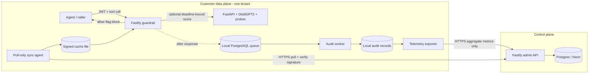

# agent-guardrail-lab

[](https://github.com/jcastellobranco/agent-guardrail-lab/actions/workflows/ci.yml)

A learning and portfolio project for latency-sensitive, tenant-aware runtime enforcement of AI agent tool calls. A local guardrail evaluates deterministic restrictions and optional activation probes before returning allow, flag or block. Centralized policy administration is separated from customer-side enforcement, auditing and model inference. This project is not an implementation or description of any real company's architecture.

**Status: v0.6.0 source implementation.** Python offline tests executed; full Node dependencies, database integration, real-model evaluation, Docker/Helm and benchmarks still require an online development or CI environment. Do not use this lab as a production security boundary.

## Architecture



### Request flow

1. Validate bounded JSON and verify a short-lived Ed25519 JWT using preloaded public keys (`kid`, issuer, audience, expiry, `sub`, tenant and agent identity).
2. Read the tenant's immutable policy snapshot and local revocations; missing or mismatched identities are rejected, without a database query.
3. Evaluate precompiled RE2JS regex and numeric restrictions, deny/allow lists, and fail closed for incomplete deterministic checks.
4. Only if not blocked and probes enabled, send bounded tool JSON to local inference. Use the remaining global request deadline minus response headroom; abort the HTTP call on timeout.
5. Combine findings with block > flag > allow precedence. `flag` permits execution with a review marker; the caller must enforce the result. Inference errors use policy fail-open/closed while preserving deterministic blocks.
6. Send HTTP 200 for evaluated decisions, including blocks. Invalid request/auth use 400/401/403/413; unexpected evaluation failure uses 503. The caller must never treat non-200/invalid responses as permission.
7. After response, hand the full local trace to a bounded asynchronous buffer. A separate transactional queue worker inserts records idempotently. Export one-minute aggregate metrics only.

## Quickstart — Docker Compose

Requires Docker with Compose v2, and Node 22 for host demo/benchmark scripts. With images built and cached, deterministic startup is designed to take under five minutes. A cold image build or dependency install needs network and may take longer.

```bash
docker compose up -d --build
docker compose up -d --wait guardrail-api
make compose-demo
curl http://127.0.0.1:8000/metrics
```

Compose initializes two PostgreSQL 17 databases, generates **separate JWT and policy signing keys**, migrates the control DB, seeds a tenant/policy, and pulls the first signed snapshot. Localhost ports: 8000 guardrail, 8002 control plane; the inference service and database ports are not published. `make compose-demo` issues a five-minute token and demonstrates allow, block, flag. The seeded rules permit transfers up to 10,000 and flag notes matching `SECRET-[0-9]+`. Local development HTTP and default credentials are deliberately insecure and must not be reused outside the lab. `docker compose down` preserves named volumes; `docker compose down -v` deletes all local data and keys.

### Optional real inference

The first download and training can take longer than five minutes. Start the model profile, then enable probes on the existing demo policy with an exploratory latency budget. This is not a measured guarantee.

```bash
LATENCY_BUDGET_MS=500 docker compose --profile probes up -d --build
# Wait for the inference container to become healthy.
docker compose --profile probes up -d --wait inference-service
PROBES_ENABLED=1 POLICY_LATENCY_BUDGET_MS=500 node scripts/compose-demo.mjs policy
# Wait for the next policy sync (default five seconds).
make compose-demo
```

To restore deterministic-only mode: `node scripts/compose-demo.mjs policy`. The default enforcement budget is 50 ms. The Python service rejects new inference when its single forward-pass slot is occupied; cancelling HTTP does not necessarily stop PyTorch work. Probe scores are illustrative, not proven security classifications.

### Without Docker (milestones 1–2)

```bash
corepack enable
corepack prepare pnpm@10.12.4 --activate
make setup
make dev
# other terminal
make demo
```

This mode deliberately permits an unsigned local development fixture, which is rejected when `NODE_ENV=production`. `pnpm keys` generates local dev keys and a demo bundle; restart the API after changes. The dev command builds once and watches compiled server output; rebuild after changing TypeScript. No lockfile was generated offline: run `pnpm install` and commit `pnpm-lock.yaml`, then switch CI/Docker to frozen lockfile installs. Never commit `.dev-keys`, tokens, customer traces or credentials.

For standalone Python: `make inference-setup`, `make inference-test`, `make inference-train`, `make inference-serve`. See [inference service](apps/inference-service/README.md).

## Services and endpoints

| Service | Role |
|---|---|
| guardrail-api | `POST /v1/check`, `/health/live`, `/health/ready`, `/health/serving`, `/metrics` |
| inference-service | `POST /v1/score`, health endpoints; internal only |
| control-plane | `/v1/admin/tenants`, nested `/agents`, `/policy`, `/token`, `/revoke`; `/v1/sync/:tenantId/bundle`, `/probe-versions`, `/telemetry` |
| sync-agent | Outbound polling, no inbound port; signed file atomic rename |
| audit-worker | Postgres durable queue consumption, retries, dead letters |
| telemetry-exporter | Local aggregate observations, durable window cursor and authenticated HTTPS upload |

Admin endpoints use a distinct high-entropy bearer credential; sync endpoints use tenant-scoped credentials. The lab exposes list/create/update/soft-delete operations and rejects non-increasing policy versions. Tenant/agent/policy deletion means deactivation, not destructive history removal. Bundle and JWT signing keys are separated. The sync agent authenticates HTTPS, verifies signatures over exact serialized bytes, rejects unknown keys, cross-tenant bundles, expired incoming bundles and non-increasing versions. Guardrail verifies again. A signed snapshot survives restart on a persistent local volume. A compromised filesystem can still roll back the whole persistent volume. Bundle freshness is based on issuance, not reload time. When unreachable, the last valid cache continues until maximum age or expiry; after that, per-policy failure mode applies. `/health/ready` reports freshness, `/health/serving` reports whether a snapshot is loaded so the Helm service still routes stale-policy checks.

## Model and probe evaluation

DistilGPT2 (~82M parameters) runs on CPU. A hook captures the fourth transformer block (zero-based 3), mean-pools token activations (768 dimensions), and computes all active probe logits with one matrix operation: `sigmoid(W @ h + b)`. No text generation or vocabulary logits. Training fits a scaler and logistic regression on a stratified training split; the holdout reports precision, recall, FPR and confusion matrix. Scaling is folded into weights. Artifacts bind probe version, model snapshot, layer, token limit, input format, dataset hash and split seed. Policy requests exact `probeId:version`; mismatches fail according to policy. The 40-sample toy dataset is educational, English-only and not production validation. Artifacts are prepared locally, not downloaded by the sync agent. The signed policy bundle carries required probe version metadata; artifact signing and distribution are future work.

## Audit, telemetry and database

The control and data planes use separate databases. Local queue uses `FOR UPDATE SKIP LOCKED`, a savepoint and atomic insert/ack. Decision UUID is the idempotency key; invalid/failed records get delayed retries and a DLQ after three attempts. Producers can lose events before durable enqueue on crash or overload; `guardrail_audit_dropped_total` exposes this. The optional LISTEN/NOTIFY optimization is not implemented; a future direct session connection can wake polling, but NOTIFY is not durable. Do not use a transaction-mode pooler for LISTEN.

The exporter reads only observation fields, aggregates decision counts per policy/probe, disjoint score buckets, p50/p95/p99 by stage, observed cache age and versions. A strict allowlist schema rejects unexpected fields at all nested levels; prompts, arguments, agent IDs and full traces are not sent. Ingest deduplicates by tenant/deployment/window. Windows use processing time, not original event time. Empty windows have zero observed cache age and version; local Prometheus gauges expose live freshness. The lab uses a bounded window query (10,000 events); larger windows stall with explicit warning rather than silently truncating. A production system should use bounded histograms/SQL aggregation and partitioned tables, retention, encryption, role-based access, and privacy thresholds.

Control migrations use Drizzle: `pnpm --filter @lab/database migrate` with `DATABASE_URL`. The active expand migration adds `display_name` and backfills; the API dual-writes `name` and `display_name`. A separate example contract migration is not in the active journal: switch all readers/writers, backfill once more, then enforce NOT NULL and remove `name` in a later release. Never apply the example before the cutover. Use an isolated Neon project/parent for PR branches; missing `NEON_API_KEY` or `NEON_PROJECT_ID` secrets skips CI branch setup. See [Neon branch action](https://github.com/neondatabase/create-branch-action) and [Cosign](https://github.com/sigstore/cosign).

## Kubernetes and releases

The Helm chart deploys a single-tenant data-plane pod with guardrail, sync agent, audit worker, telemetry exporter, and optional inference sidecar. Provide a persistent local audit DB initialized with `packages/local-audit/sql/001_queue.sql`, a Secret containing public verification keys and sync/local DB credentials, and optionally pre-populated artifact/model PVCs. No private signing keys belong in the data plane. For actual production, add network policies, separate service identities, TLS/mTLS, hardened secrets, storage encryption and backups. See `infrastructure/helm/data-plane/values.yaml`.

```bash
helm lint infrastructure/helm/data-plane
helm template lab infrastructure/helm/data-plane
# After provisioning secrets, database, images and storage:
helm upgrade --install lab infrastructure/helm/data-plane
```

CI runs TS lint/typecheck/tests/build, Python tests, actual candidate probe training and an FPR regression gate against the PR base, image builds, Compose integration, and Helm lint/render. The FPR gate rejects incomparable dataset/split/threshold metadata and regressions >5 percentage points, with a 60% bootstrap ceiling for toy data. The gate and release workflows have not yet executed. Neon PR branch workflow creates schema-only branches, creates a fresh temporary database per CI run (role requires CREATEDB), migrates and tests, deletes on PR close and sets expiration. Tags like `v0.6.0` trigger image builds to GHCR and keyless Cosign signatures by digest. Use protected tags and required CI checks before releasing; no images or tags have been published from this environment.

## Tests and benchmarks

```bash
pnpm install
pnpm lint && pnpm typecheck && pnpm test && pnpm build
make inference-test
make integration     # isolated Compose project, tests allow/block/flag/timeout/open/closed/outage/staleness/queue
```

Install k6 on the host, run the `probes` Compose profile and wait for inference to be healthy, then:

```bash
VUS=5 DURATION=30s BENCHMARK_BUDGET_MS=50 make benchmark
```

This runs two scenarios on the same machine, creates a new JWT per run, captures p50/p95/p99 of valid HTTP evaluations, degraded and probe-scored rates, and writes raw summaries and CPU/RAM/kernel/Docker info to `benchmarks/results/`. A fast fail-closed timeout is not successful AI inference; compare the probe-scored rate alongside latency. Increase `LATENCY_BUDGET_MS` before Compose startup and `BENCHMARK_BUDGET_MS` for a relaxed CPU budget. The runner resets the demo policy afterward. Stop other local workloads before benchmarking.

| Scenario | p50 | p95 | p99 | Probe scored / degraded |
|---|---|---|---|---|
| Deterministic only | Pending | Pending | Pending | Pending |
| With real probes | Pending | Pending | Pending | Pending |

**Machine specs for actual benchmark:** pending. No latency or real-model quality results are claimed. The authoring environment lacked npm registry access, Docker, Helm, Transformers and model weights. Python offline tests were run successfully; the actual model smoke test was skipped. The CI and Compose integration tests are present but not executed in this environment.

## Design decisions and trade-offs

| Decision | Rationale and limitations |
|---|---|
| Fastify vs Hono | Persistent Node services, explicit lifecycle hooks and structured logs; Hono is attractive for edge runtimes. |
| Rules vs probes vs LLM judge | Rules are predictable and cheap; probes capture learned signals with one forward pass; LLM judging can use richer context but costs more latency, so better as async review. |
| Sync vs async | Enforcement is synchronous within a deadline; audit and telemetry run asynchronously with explicit loss/retry trade-offs. |
| Fail open vs closed | Availability vs safety; fail-open is limited to degraded optional checks, never authentication, isolation or known deterministic violations. |
| Silo vs pool | Silo offers stronger workload/data separation with greater cost. Pool requires RLS, tenant quotas, tenant-aware rate limiting and fair scheduling; not implemented. |
| Kubernetes vs managed inference | Local Kubernetes keeps sensitive inputs local and predictable; managed endpoints simplify scaling but add network and governance constraints. |
| JWT vs API keys | Offline verification avoids per-request database calls; short token TTL and synced revocation trade freshness for resilience. Admin/sync use separately scoped credentials. |
| PostgreSQL queue vs SQS | Local durable Postgres supports transactional idempotence and offline deployments; SQS reduces broker operations but requires cloud connectivity and consumer deduplication. |
| Single deadline vs per-call timeouts | Remaining-time budget protects end-to-end latency. JS timers are not hard real-time guarantees; monitor event loop delay and offload heavy policy compilation/crypto bursts to workers if needed. |

## Limitations and next steps

- This service advises a caller; it cannot enforce tool execution unless integrated into the agent's actual execution path. MCP proxy/SDK are stretch goals.
- Toy dataset and small model cannot establish jailbreak detection efficacy. Add representative multilingual, adversarial and independently labeled evaluation sets, calibration, shadow/canary rollout and reviewed thresholds.
- A 50 ms default budget is a target, not a hard SLA. CPU inference may frequently time out; load-test before choosing hardware/model and concurrency.
- Local key files and sync credentials are a lab mechanism. Add KMS/rotation, trusted enrollment, mTLS, per-tenant rate limits, RLS/non-owner DB roles for pool mode, supply-chain pinning and independent security review.
- Raw audit records remain customer-side; production requires encryption at rest, access controls, retention/redaction, stronger queue delivery, retry monitoring and recovery tooling. Telemetry is a bounded prototype, not a lossless compliance pipeline.
- Sync assumes a single writer and a protected volume. Probe artifacts are locally provisioned; no remote artifact distribution/signatures or automatic rollback. No LISTEN/NOTIFY bonus yet.
- All workflows and infrastructure are implementation candidates until validated in CI. No fabricated results or production-readiness claims.

See [ADRs](docs/adr/) for the reasoning behind architectural choices.

## Dependency maintenance

Use Node 22 and pnpm 10.12.4. Run `pnpm install --frozen-lockfile` for normal installs. After intentionally changing package manifests, run `pnpm install --no-frozen-lockfile` and commit the updated lockfile.

The Python lock targets Linux x86-64, Python 3.12 and CPU PyTorch. To regenerate it in a fresh virtual environment, install `torch==2.10.0` from `https://download.pytorch.org/whl/cpu`, install `apps/inference-service/requirements.txt`, and run `pip freeze > apps/inference-service/requirements.lock.txt`. For normal installs, install CPU torch first and then the lockfile. Run `pip check` after installation. This is a version lock, not a hash-verified lock or a cross-platform guarantee.

### PostgreSQL integration checks

CI provisions an isolated PostgreSQL 17 service, builds the workspace dependencies, applies migrations twice to verify replay, and runs the Control Plane database suite directly (without Turbo caching). `REQUIRE_DATABASE_TESTS=1` prevents a missing `TEST_DATABASE_URL` from silently skipping the suite. For local reproduction, set `DATABASE_URL` and `TEST_DATABASE_URL` to a disposable PostgreSQL database, run `pnpm --filter @lab/control-plane... build`, `pnpm --filter @lab/database migrate`, and `REQUIRE_DATABASE_TESTS=1 pnpm --filter @lab/control-plane exec vitest run tests/database.test.ts`.
