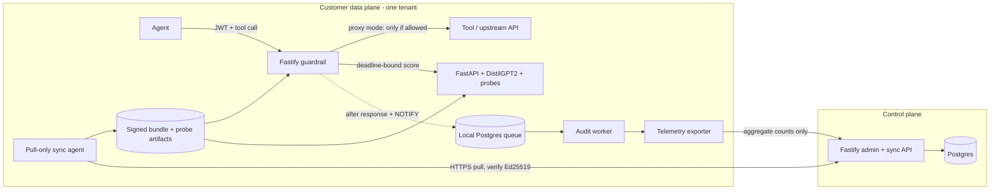

# agent-guardrail-lab

[](https://github.com/jcastellobranco/agent-guardrail-lab/actions/workflows/ci.yml)

A runtime guardrail for AI agent tool calls. Before an agent runs a tool (say, `transfer_money`), the call goes to a guardrail running next to the agent in the customer's environment. Within a 50 ms budget, the guardrail checks the agent's identity, applies the tenant's signed policy (allow/deny lists, numeric limits, regex rules), and can optionally score the call with linear probes on a small language model's activations. It answers `allow`, `flag` or `block`, or, in proxy mode, forwards the call to the tool only if allowed. A central control plane manages tenants and policies, but nothing on the request path depends on it: the data plane keeps enforcing from its last signed snapshot when the control plane is down. This is a learning and portfolio project, not a description of any real company's system and not a production security boundary.

## Architecture



### What happens on a request

1. The guardrail checks the body size and JSON depth, then verifies the agent's short-lived Ed25519 JWT against public keys already in memory.
2. It looks up the agent's policy in the in-memory signed snapshot, with no database call. Revoked tokens and mismatched tenant or agent identities are rejected here.
3. It runs the precompiled deterministic rules: deny and allow lists, numeric limits, and RE2 regexes that cannot backtrack. If these rules can't finish, the answer is `block`.
4. If nothing has blocked yet and the policy enables probes, it sends the tool call to the local inference service, using whatever is left of the request deadline, and aborts the call if time runs out.
5. It combines the findings: block beats flag, and flag beats allow. If inference fails, the policy's fail mode decides, but a deterministic block always stands.
6. It answers `200` with the decision (`/v1/check`), or forwards the call to the tool and returns its response (`/v1/proxy/:tool`). Errors are never permission: callers must treat any non-200 as "do not run".
7. After responding, it hands the trace to a bounded in-memory buffer. That buffer writes it to a local Postgres queue and wakes the audit worker with `NOTIFY`. Only one-minute aggregate counts ever leave the customer's environment.

## Quickstart

Requires Docker with Compose v2 and Node 22 on the host for the demo scripts.

```bash
docker compose up -d --build
docker compose up -d --wait guardrail-api
make compose-demo   # allow, block (over the 10,000 limit), flag (note matches SECRET-[0-9]+)
make proxy-demo     # the same three calls through proxy mode: only allowed and flagged ones reach the tool
curl -s http://127.0.0.1:8000/metrics | grep guardrail_
```

On a warm Docker cache this took 34 s end to end (Apple M4, Docker Desktop). The first build downloads base images and dependencies, so it takes longer. Compose creates two Postgres databases, generates separate JWT and bundle signing keys, seeds a tenant and policy, and pulls the first signed snapshot. Only the guardrail (8000) and control plane (8002) are published on localhost. The credentials are deliberately local-only. `docker compose down -v` deletes everything.

More profiles:
- **Real inference:** `LATENCY_BUDGET_MS=500 docker compose --profile probes up -d --build`, then `PROBES_ENABLED=1 POLICY_LATENCY_BUDGET_MS=500 node scripts/compose-demo.mjs policy`. The first model download and probe training take several minutes.
- **Tracing:** `OTEL_EXPORTER_OTLP_ENDPOINT=http://jaeger:4318 docker compose --profile tracing up -d`, then open http://127.0.0.1:16686.
- **Without Docker:** see [operations](docs/operations.md).

## Features

| Area | What it does | Details |
|---|---|---|
| Enforcement | `/v1/check` advises; `/v1/proxy/:tool` forwards to an allowlisted upstream only when permitted, so a blocked call cannot reach the tool | [Proxy mode](#proxy-mode-enforcement-instead-of-advice) |
| SDK | `@lab/sdk`: `check`, `guard`, `proxy`, one deadline across retries, retries only 503 and connection failures, never treats an error as allow | [packages/sdk](packages/sdk/README.md) |
| Policy distribution | Signed, versioned, tenant-scoped bundles pulled by the data plane; rollback and replay rejected | [ADR 0009](docs/adr/0009-signed-pull-sync.md) |
| Probes | One DistilGPT2 forward pass, all probes as one matrix multiply; shadow scoring, canary rollout with automatic rollback, signed artifact sync with hot reload | [Probe rollout](docs/probe-rollout.md) |
| Audit | Postgres queue with `SKIP LOCKED`, idempotent inserts, retries and a dead-letter table; LISTEN/NOTIFY wake-up with polling as reconciliation | [ADR 0013](docs/adr/0013-listen-notify-wakeup.md) |
| Observability | Stage histograms, event-loop delay, cache age, shadow comparison counters; OpenTelemetry spans per stage to Jaeger | [Observability](docs/observability.md) |

## Proxy mode: enforcement instead of advice

`POST /v1/check` returns a decision and trusts the caller to respect it. That is an SDK-style check: a buggy, compromised or prompt-injected agent can skip the call, ignore a `block`, or treat an error as permission, because it still has a direct route to the tool.

`POST /v1/proxy/:tool` removes that route. The agent sends the call to the guardrail, which runs the same evaluation and forwards it to the tool's upstream URL only when the decision permits it:

| Decision | Response | Reaches the tool? |
|---|---|---|
| `allow` | 200 `{forwarded: true, decision, upstream: {status, body}}` | yes |
| `flag` | 200 (default) or 403 with `PROXY_FLAGGED_CALLS=block` | per configuration |
| `block`, including fail-closed inference timeouts and stale policy | 403 `{forwarded: false, decision}` | no |
| invalid token, invalid body, tool name mismatch, evaluation error | 400/401/403/503 | no |
| permitted but no upstream configured | 404 `TOOL_NOT_REGISTERED` | no |
| upstream unreachable, timed out or oversized response | 502 | attempted |

Only URLs in `TOOL_UPSTREAMS_JSON` are ever contacted. The tool name comes from the path and must match the body, so the evaluated call is the forwarded call. The agent's JWT is not forwarded.

The guarantee depends on the network, not on the code: the tool must accept traffic only from the guardrail. In Compose, `mock-tool` has no published port. In Kubernetes that means a NetworkPolicy, or mTLS where the tool verifies the guardrail's identity.

## Benchmarks

Measured on a GitHub-hosted runner (AMD EPYC 9V74, 4 vCPUs, 15.6 GiB RAM), 30 s per scenario after a 5 s warm-up, 50 ms budget, fail-closed, with the k6 load generator on the same machine. Full numbers are in the [run report](benchmarks/runtime-2026-11-26.md) ([raw metrics](benchmarks/runtime-2026-11-26.json)).

| Scenario | VUs | p50 | p95 | p99 | Throughput | Probe-scored | Degraded |
|---|---:|---:|---:|---:|---:|---:|---:|
| Deterministic only | 1 | 0.55 ms | 0.96 ms | 1.77 ms | 1,352 req/s | n/a | 0 % |
| Deterministic only | 5 | 1.47 ms | 3.09 ms | 4.78 ms | 2,703 req/s | n/a | 0 % |
| With real probes | 1 | 37.9 ms | 47.0 ms | 48.8 ms | 38 req/s | 36.8 % | 63.2 % |
| With real probes | 5 | 9.2 ms | 21.4 ms | 46.9 ms | 449 req/s | 0 % | 100 % |

**How to read this:**
- The deterministic path is about 1–5 ms, so most of the 50 ms budget is free.
- With CPU inference, the budget is the bottleneck. With one user, 63 % of calls timed out and failed closed.
- With five users, *every* call was degraded, so the low latency in that row is fast failure, not fast scoring. That fits the inference service's single forward-pass slot rejecting concurrent requests, but the run did not record failure reasons, so timeout versus saturation is still unconfirmed.
- That is the fail-closed design working as intended, and the honest trade-off: real-time probes need a GPU, a smaller model, or a larger budget.

A relaxed-budget run has not been recorded yet. To reproduce, or to measure your own machine with a relaxed budget:

```bash
LATENCY_BUDGET_MS=500 docker compose --profile probes up -d --build
VUS=1 DURATION=30s BENCHMARK_BUDGET_MS=500 make benchmark   # requires k6 on the host
```

## Design decisions and trade-offs

| Decision | Rationale and limitations |
|---|---|
| Fastify vs Hono | Persistent Node services, explicit lifecycle hooks and structured logs; Hono is attractive for edge runtimes. |
| Rules vs probes vs LLM judge | Rules are predictable and cheap; probes capture learned signals with one forward pass; an LLM judge can use richer context but costs far more latency, so it fits asynchronous review better. |
| Sync vs async | Enforcement is synchronous within a deadline; audit and telemetry are asynchronous, with explicit loss and retry trade-offs. |
| Fail open vs closed | Availability vs safety. Fail-open is limited to degraded optional checks, never authentication, isolation or known deterministic violations. |
| Advisory check vs proxy | A check is easy to adopt but trivially bypassed; a proxy enforces, but only with network isolation, and it puts the guardrail on the tool's availability path. |
| Silo vs pool | Silo gives stronger workload and data separation at greater cost. Pool would need RLS, tenant quotas, tenant-aware rate limiting and fair scheduling; not implemented. |
| Kubernetes vs managed inference | Local inference keeps sensitive inputs in the customer's environment with predictable latency; managed endpoints simplify scaling but add network and governance constraints. |
| JWT vs API keys | Offline verification avoids per-request database calls; a short TTL plus synced revocation trades freshness for resilience. Admin and sync use separately scoped credentials. |
| PostgreSQL queue vs SQS | A local Postgres queue gives transactional idempotence and works offline; SQS removes broker operations but needs cloud connectivity and consumer deduplication. |
| NOTIFY vs polling | NOTIFY gives millisecond wake-up but isn't durable, so polling stays as the correctness path. |
| Single deadline vs per-call timeouts | A remaining-time budget protects end-to-end latency. JS timers are not hard real-time, so event-loop delay is exported, and heavy work belongs in worker threads. |
| Canary signal: block rate | Needs no labels and catches a probe that over-blocks; cannot catch one that under-blocks, which still needs labelled evaluation. |

## What I learned

> Draft: rewrite these in your own words before sharing.

- **A deadline is a budget, not a timeout.** Passing the *remaining* time to each stage, and failing closed when it runs out, made latency predictable. The benchmarks then showed that the expensive part (CPU inference) needs a different budget, not a faster check.
- **Advice is not enforcement.** `/v1/check` only works if the caller cooperates. Making the guardrail a proxy, and making the network the actual boundary, is what turns a policy into a control.
- **Durability and latency are separate problems.** In the audit queue, Postgres rows give durability and NOTIFY gives latency. Treating NOTIFY as a hint, with polling as reconciliation, keeps both without trusting the fast path for correctness.
- **Ship a model like code.** Signed, immutable artifacts, a shadow phase and a canary with automatic rollback made a probe version change reversible. Measuring block rate taught me exactly what that signal can and can't detect.
- **Errors must never look like permission.** That rule ended up everywhere: HTTP status design, the SDK (`throw`, never `allow`), the sync agent (reject the bundle rather than reference missing weights).

## Limitations

- Toy dataset (40 English examples) and a small model: the probes demonstrate the mechanism, not jailbreak-detection quality.
- CPU inference does not fit a 50 ms budget under load (see benchmarks); 50 ms is a target, not an SLA.
- Proxy mode enforces only with network isolation, speaks JSON over HTTP rather than MCP, and handles flagged calls with a deployment setting rather than per-agent policy.
- Keys live in local files and sync credentials are static. Production would need KMS and rotation, trusted enrollment, mTLS, per-tenant rate limits, and an independent security review.
- Audit events can be lost before durable enqueue (crash or overload, counted by `guardrail_audit_dropped_total`); raw audit records would need encryption, retention and access controls.
- Single-tenant silo only. The inference service trusts its local artifact volume and does not re-verify signatures.

Architecture decisions: [docs/adr](docs/adr/). Operations, Helm, releases and dependency maintenance: [docs/operations.md](docs/operations.md).

## Tests

```bash
pnpm install --frozen-lockfile
pnpm format:check && pnpm lint && pnpm typecheck && pnpm test && pnpm build
make inference-test   # Python: ruff + pytest
make integration      # isolated Compose stack: allow/block/flag, proxy, timeouts, fail open/closed, outage, staleness, audit queue
```

Postgres-backed suites (control plane, canary rollouts, artifacts, audit worker) run in CI against a real database; see [operations](docs/operations.md#postgresql-tests) to run them locally.
